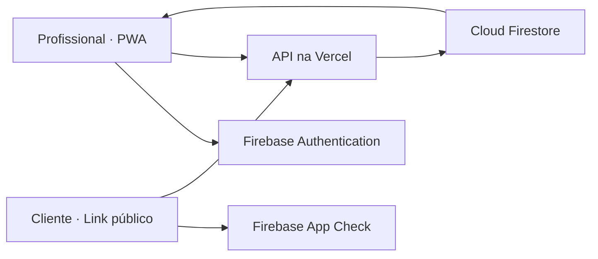

<div align="center">


**Mais organização para quem cuida. Mais facilidade para quem agenda.**


[Acessar o aplicativo](https://agenda-estetica-phi.vercel.app) · [Executar localmente](#executar-localmente) · [Configurar a nuvem](docs/firestore-deployment.md)

</div>

## Um espaço para organizar o seu tempo

O **BelaHora** é uma agenda para profissionais de estética, pensada para acompanhar a rotina de atendimentos no celular ou no computador. Reúne clientes, serviços, horários e valores em uma interface acolhedora, com tons suaves e foco no que importa: cuidar de cada atendimento.

Na versão em nuvem, a agenda acompanha a conta. Ao entrar com o mesmo login em outro aparelho, os dados são carregados do Firebase. A aplicação é hospedada na Vercel e funciona independentemente do notebook do desenvolvedor.

## O que você encontra

| Recurso | Na prática |
| --- | --- |
| Agenda de atendimentos | Criação, edição, reagendamento e cancelamento |
| Informações da cliente | Nome, telefone, serviços, valor e observações em cada atendimento |
| Sincronização por conta | A mesma agenda em diferentes aparelhos |
| Catálogo personalizado | Cada profissional cadastra seus serviços e preços; novas contas começam sem serviços |
| Link de agendamento | A cliente escolhe serviço e horário e confirma a reserva pelo link compartilhado |
| Proteção de horários | Disponibilidade conferida no servidor para evitar reservas simultâneas no mesmo horário |
| Aplicativo instalável | PWA para abrir pela tela inicial do celular |
| Migração e backup | Importação da agenda antiga, cópia preservada e conferência de conflitos |

## Como funciona



O login identifica a conta; as regras do Firestore limitam a leitura à própria agenda. As gravações passam pela API, que valida permissões, dados e disponibilidade. O link público usa App Check e entrega apenas as informações necessárias à reserva.

**Com internet:** sincronização entre aparelhos e gravação de alterações. **Sem internet:** consulta de dados previamente carregados, quando há sessão e cache disponíveis. No modo nuvem, criar ou alterar atendimentos exige conexão.

## Tecnologias

- **Interface:** React 19, TypeScript, Vite, Tailwind CSS e Lucide.
- **Autenticação e banco:** Firebase Authentication, Cloud Firestore e Firebase Admin.
- **Servidor e hospedagem:** funções da Vercel e aplicação web estática.
- **PWA e armazenamento local:** vite-plugin-pwa, service worker e IndexedDB.
- **Qualidade:** Vitest, Playwright, emuladores Firebase, ESLint e TypeScript.

## Executar localmente

Requisitos: **Node.js 22.12+** e npm. O projeto também foi validado com Node.js 24.

```bash
git clone https://github.com/otaviorodriguess/belahora.git
cd belahora
npm ci
```

Copie `.env.example` para `.env.local`. No PowerShell:

```powershell
Copy-Item .env.example .env.local
npm run dev
```

Abra **http://localhost:5173**.

A configuração de exemplo inicia no **modo local**, sem login nem sincronização. Esse modo permite conhecer a interface sem credenciais. Para ativar o Firebase, configure um projeto próprio e siga o [manual de implantação](docs/firestore-deployment.md). O `npm run dev` inicia o frontend; as APIs da nuvem exigem um ambiente de funções compatível, como a Vercel.

### Variáveis de ambiente

| Variável | Finalidade |
| --- | --- |
| `VITE_AUTH_ENABLED` | Ativa login por e-mail e senha |
| `VITE_FIREBASE_API_KEY`, `VITE_FIREBASE_AUTH_DOMAIN` | Configuração pública do aplicativo Firebase |
| `VITE_FIREBASE_PROJECT_ID`, `VITE_FIREBASE_APP_ID` | Identificação do projeto e aplicativo |
| `VITE_CLOUD_AGENDA_ENABLED` | Ativa a agenda em nuvem após configurar o servidor |
| `VITE_PUBLIC_BOOKING_ORIGIN` | Endereço público do aplicativo |
| `VITE_APPCHECK_SITE_KEY` | Chave pública do reCAPTCHA para App Check |
| `FIREBASE_SERVICE_ACCOUNT_JSON` | Credencial privada, **somente no servidor** |
| `BOOKING_RATE_SECRET` | Segredo do limitador de requisições, **somente no servidor** |

Nunca coloque credenciais privadas em variáveis `VITE_*`: elas são incorporadas ao frontend. Arquivos `.env`, credenciais, backups, dados de clientes e resultados locais de testes não pertencem ao repositório.

## Instalar no celular

- **Android:** abra o aplicativo no Chrome e escolha **Instalar aplicativo**.
- **iPhone:** abra no Safari, toque em **Compartilhar → Adicionar à Tela de Início**.
- **Computador:** use a opção de instalação do Chrome ou Edge.

Para migrar uma agenda antiga, exporte um backup e abra a versão atualizada no mesmo aparelho, conectado à internet. Aguarde a importação e confira os dados em outro aparelho antes de limpar o armazenamento original.

## Desenvolvimento e testes

```bash
npm run lint
npm test
npm run build
npm run test:server:runtime
```

Os testes de integração utilizam o projeto fictício `demo-belahora`. Os emuladores precisam de Java 21; os testes de navegador precisam do Chromium do Playwright:

```bash
npx playwright install chromium
npm run test:cloud
npm run test:booking
npm run test:auth:pwa
npm run test:local
```

Execute as suítes que usam emuladores sequencialmente para evitar disputa por portas. Não direcione os testes ao banco de produção. O [relatório de validação](docs/firestore-validation.md) registra os cenários verificados e suas limitações.

## Organização do projeto

```text
api/          Endpoints de agenda e reserva pública
server/       Validação, persistência e migração
shared/       Tipos e regras compartilhadas de agendamento
src/          Interface, autenticação e armazenamento local
public/       Ícones e identidade do PWA
tests/        Testes unitários, de integração e navegador
scripts/      Ferramentas de desenvolvimento e validação
docs/         Implantação, validação e documentação
```

## Implantação

O projeto inclui configuração da Vercel, regras e índices do Firestore. Configure as variáveis nos ambientes corretos, publique as regras e valide a sincronização antes de ativar a nuvem. Firebase e Vercel têm cotas de uso; acompanhe o consumo do projeto.

Veja o [guia de implantação e recuperação](docs/firestore-deployment.md).

---

<div align="center">

**BelaHora · Tempo para organizar. Espaço para cuidar.**

Desenvolvido por [Otávio Rodrigues](https://github.com/otaviorodriguess).

</div>
